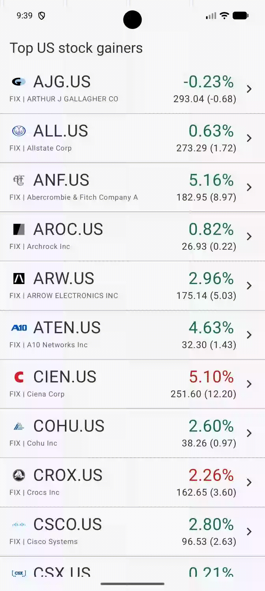

## What was done:

1. Fetch top 30 US stocks from https://tradernet.com/tradernet-api/quotes-get-top-securities
2. Display logo of a company for ticker using https://tradernet.com/logos/get-logo-by-ticker?ticker= + lowercased ticker
3. Subscribe for quotes using websocket wss.tradernet.com
4. Flash a background for the last updated pcp for 1 sec
5. Empty state while subscribing to websocket, similar to tradernet app
6. Error handling is only implemented for fetching top 30 stocks, not websocket connection errors

